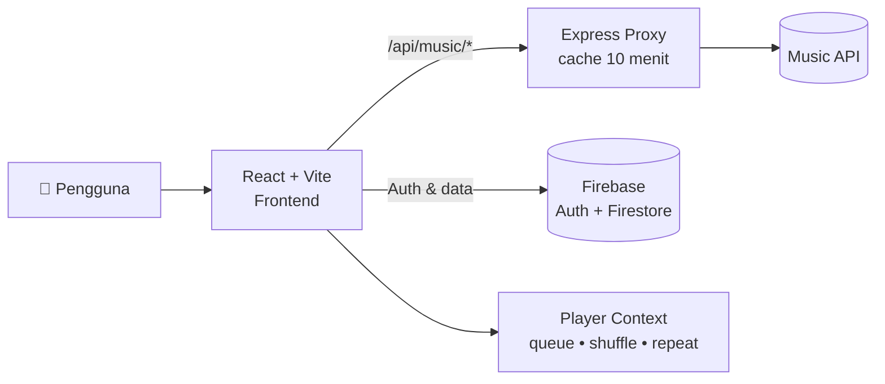
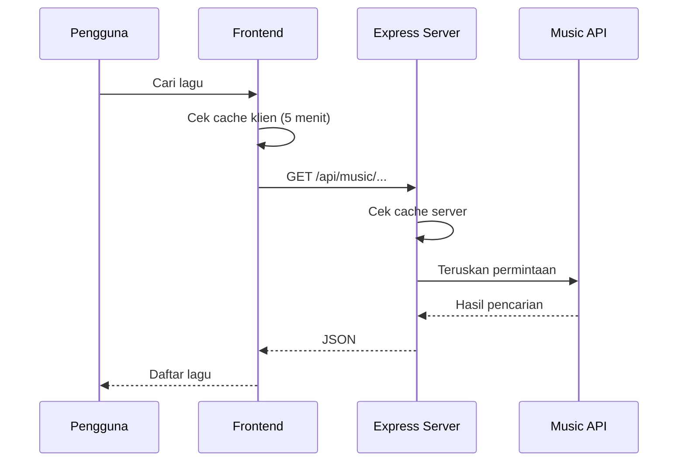

<a id="top"></a>

<div align="center">


<a href="https://github.com/ItsMeMal/SoundWave">
  
</a>

<br/>

<p>
  
  
  
  
  
</p>

<p>
  
  
  
  
  
  
</p>

<p>
  <a href="#-fitur">Fitur</a> •
  <a href="#-tech-stack">Tech Stack</a> •
  <a href="#-instalasi">Instalasi</a> •
  <a href="#-konfigurasi">Konfigurasi</a> •
  <a href="#-arsitektur">Arsitektur</a> •
  <a href="#-faq">FAQ</a>
</p>


</div>

---

## 📖 Tentang

**SoundWave** adalah platform streaming musik modern yang memadukan keunggulan Spotify dan YouTube Music, dibungkus dengan desain dark premium yang elegan. Kamu bisa mencari lagu, memutar lewat player yang lengkap, membaca lirik, membuat playlist, dan menyimpan lagu favorit ke akunmu.

<details>
<summary><b>📋 Daftar Isi</b></summary>

- [Fitur](#-fitur)
- [Tech Stack](#-tech-stack)
- [Instalasi](#-instalasi)
- [Konfigurasi](#-konfigurasi)
- [Script](#-script)
- [Arsitektur](#-arsitektur)
- [Struktur Project](#-struktur-project)
- [Deploy](#-deploy)
- [FAQ](#-faq)
- [Kontribusi](#-kontribusi)
- [Lisensi](#-lisensi)

</details>

---

## ✨ Fitur

| | Fitur | Keterangan |
|---|-------|------------|
| 🔍 | **Pencarian** | Cari lagu, artis, dan album langsung dari halaman Search |
| 🎵 | **Player lengkap** | Play/pause, seek, volume, mute, shuffle, repeat, dan antrean (queue) |
| ♾️ | **Autoplay** | Lanjut memutar lagu berikutnya otomatis |
| 📝 | **Lirik** | Halaman lirik khusus untuk lagu yang sedang diputar |
| 📂 | **Playlist** | Buat playlist sendiri dan tambahkan lagu ke playlist mana pun |
| ❤️ | **Liked Songs** | Simpan lagu favorit ke akun |
| 🕘 | **Riwayat putar** | Catatan lagu yang pernah kamu dengar |
| 👤 | **Akun** | Daftar dan login dengan email/password atau Google |
| ⚙️ | **Pengaturan** | Kualitas putar & unduh, autoplay, tema, dan bahasa (English / Bahasa Indonesia) |
| 📱 | **Responsif** | Sidebar di desktop, navigasi bawah dan drawer di HP |
| ⚡ | **Cepat** | Cache respons API di sisi server dan klien |

> [!NOTE]
> Data akun, playlist, dan lagu favorit disimpan di **Firebase** (Authentication + Firestore), jadi tersinkron di semua perangkat.

---

## 🧰 Tech Stack

<div align="center">


</div>

<details>
<summary><b>📚 Library utama</b></summary>
<br>

| Kategori | Yang dipakai |
|----------|--------------|
| UI | React 19, Tailwind CSS 4, Motion, Lucide React |
| Build | Vite, TypeScript, tsx |
| Server | Express (proxy API + static serving) |
| Backend as a Service | Firebase Auth & Firestore |
| Font | Plus Jakarta Sans |

</details>

---

## 🚀 Instalasi

**Prasyarat:** Node.js 18+ (atau Bun)

<details open>
<summary>🐧 <b>Linux / macOS</b></summary>

```bash
git clone https://github.com/ItsMeMal/SoundWave.git
cd SoundWave
npm install
cp .env.example .env
npm run dev
```

</details>

<details>
<summary>🪟 <b>Windows (PowerShell)</b></summary>

```powershell
git clone https://github.com/ItsMeMal/SoundWave.git
cd SoundWave
npm install
Copy-Item .env.example .env
npm run dev
```

</details>

<details>
<summary>📱 <b>Termux (Android)</b></summary>

```bash
pkg update && pkg upgrade -y
pkg install git nodejs -y
git clone https://github.com/ItsMeMal/SoundWave.git
cd SoundWave
npm install
cp .env.example .env
npm run dev
```

</details>

<details>
<summary>🥟 <b>Bun</b></summary>

```bash
bun install
bun run dev
```

</details>

Setelah berjalan, buka **http://localhost:3000**.

> [!TIP]
> Setiap blok kode di GitHub punya tombol **Copy** di pojok kanan atas.

---

## ⚙️ Konfigurasi

Salin `.env.example` menjadi `.env`, lalu sesuaikan:

| Variabel | Wajib | Default | Keterangan |
|----------|:-----:|---------|------------|
| `GEMINI_API_KEY` | ❌ | – | Kunci Gemini API (disiapkan di template, opsional) |
| `APP_URL` | ❌ | – | URL tempat aplikasi di-host |
| `PORT` | ❌ | `3000` | Port server |
| `NODE_ENV` | ❌ | – | Isi `production` agar server menyajikan folder `dist` |
| `DISABLE_HMR` | ❌ | – | Isi `true` untuk mematikan hot reload |

<details>
<summary>🔥 <b>Pakai Firebase project sendiri</b></summary>
<br>

1. Buat project di [Firebase Console](https://console.firebase.google.com/), aktifkan **Authentication** (Email/Password dan Google) dan **Firestore**.
2. Ganti isi `firebase-applet-config.json` dengan konfigurasi web app Firebase kamu.
3. Terapkan aturan keamanan dari file `firestore.rules`.

Skema data (UserProfile, Playlist, LikedTrack, PlaybackHistory) ada di `firebase-blueprint.json`.

</details>

> [!WARNING]
> Jangan commit file `.env` ke repository publik.

---

## 📜 Script

| Perintah | Fungsi |
|----------|--------|
| `npm run dev` | Jalankan server development (Express + Vite) |
| `npm run build` | Build frontend ke folder `dist` |
| `npm start` | Jalankan server (set `NODE_ENV=production` untuk mode produksi) |
| `npm run preview` | Preview hasil build dengan Vite |
| `npm run lint` | Cek tipe TypeScript (`tsc --noEmit`) |
| `npm run clean` | Hapus `dist` dan `server.js` |

Mode produksi:

```bash
npm run build
NODE_ENV=production npm start
```

---

## 🏗️ Arsitektur





Server Express meneruskan semua permintaan `/api/music/*` ke Music API eksternal, dilengkapi cache dan timeout. Endpoint `/api/health` tersedia untuk cek status server.

---

## 🗂️ Struktur Project

```text
SoundWave/
├── src/
│   ├── components/
│   │   ├── layout/        # Sidebar, Navbar, BottomPlayerBar, RightPlayerPanel, MobileNav
│   │   └── modals/        # AuthModal, CreatePlaylistModal, AddToPlaylistModal
│   ├── context/           # AuthContext, PlayerContext
│   ├── services/          # firebase.ts, musicApi.ts
│   ├── types/             # Tipe data (Track, Playlist, UserSettings, ...)
│   ├── utils/             # formatters, playerLogic (+ test)
│   ├── views/             # Home, Search, Library, LikedSongs, Artist, Playlist, Lyrics, Settings
│   ├── App.tsx
│   ├── main.tsx
│   └── index.css
├── server.ts              # Express: proxy API + serve frontend
├── vite.config.ts
├── vercel.json            # Rewrites untuk deploy di Vercel
├── firestore.rules
├── firebase-blueprint.json
├── .env.example
└── package.json
```

---

## ☁️ Deploy

Project ini sudah menyertakan `vercel.json` berisi rewrite untuk route `/api/music/*` dan fallback SPA, jadi bisa langsung di-deploy ke **Vercel**:

1. Import repository di [Vercel](https://vercel.com/new).
2. Framework preset: **Vite**.
3. Deploy.

Untuk VPS, jalankan `npm run build` lalu `NODE_ENV=production npm start` (disarankan memakai PM2 atau reverse proxy).

<!-- GANTI: tambahkan link demo kalau sudah ada, contoh: **🌐 Live demo:** https://soundwave.vercel.app -->

---

## ❓ FAQ

<details>
<summary><b>Apakah saya perlu akun untuk memutar lagu?</b></summary>
<br>

Akun dipakai untuk menyimpan playlist, lagu favorit, dan riwayat. Daftar atau login lewat email/password atau Google.

</details>

<details>
<summary><b>Lagu tidak muncul atau gagal diputar?</b></summary>
<br>

Musik diambil dari Music API eksternal lewat proxy server. Pastikan server berjalan dan koneksi internet stabil, lalu coba lagi beberapa saat.

</details>

<details>
<summary><b>Bagaimana melaporkan bug?</b></summary>
<br>

Buka [Issues](https://github.com/ItsMeMal/SoundWave/issues/new) dan sertakan langkah untuk mereproduksi masalahnya beserta screenshot jika ada.

</details>

---

## 🤝 Kontribusi

Kontribusi sangat diterima!

1. **Fork** repository ini
2. Buat branch: `git checkout -b fitur/nama-fitur`
3. Commit: `git commit -m "feat: tambah fitur"`
4. Push: `git push origin fitur/nama-fitur`
5. Buka **Pull Request**

<a href="https://github.com/ItsMeMal/SoundWave/graphs/contributors">
  
</a>

---

## ⭐ Star History

<div align="center">
  <a href="https://star-history.com/#ItsMeMal/SoundWave&Date">
    
  </a>
</div>

---

## 📜 Lisensi

Kode sumber memakai header lisensi **Apache-2.0**. Tambahkan file `LICENSE` di root repository agar GitHub bisa menampilkannya.

<div align="center">

**Dibuat dengan ❤️ oleh [Mallssz](https://github.com/ItsMeMal)**

Kalau SoundWave bermanfaat, jangan lupa kasih ⭐

<a href="#top">⬆️ Kembali ke atas</a>


</div>
